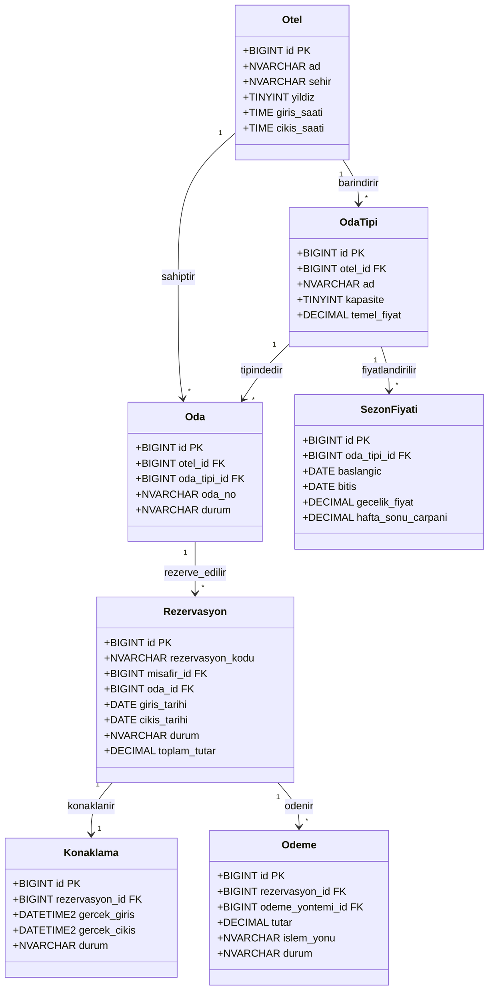

# OTEL REZERVASYON VE KONAKLAMA YÖNETİM SİSTEMİ
## Veritabanı Tasarım, Mimari ve Nesne Dokümantasyonu (OtelDB)

> **Proje Türü:** Lisans Dönem Projesi (Veritabanı Yönetim Sistemleri)  
> **Veritabanı Motoru:** Microsoft SQL Server 2022 (v16.x Developer Edition - Linux Container)  
> **Karakter Kümesi (Collation):** `Turkish_CI_AS` (Türkçe, Büyük/Küçük Harf Duyarsız, Aksan Duyarlı)  
> **Uyumluluk Seviyesi:** `160` (SQL Server 2022 Tam Özellik Seti)  
> **Tarih:** Ekim 2026

---

## 1. TEORİK TEMEL VE MİMARİ KARARLAR

### 1.1. İlişkisel Model (Relational Model)
İlişkisel veritabanı modeli, verileri satırlar (tuple/record) ve sütunlar (attribute/field) halinde organize edilmiş iki boyutlu tablolar (relation) üzerinde modeller. OtelDB, en küçük veri parçasının bile atomik olduğu, tekrarların önlendiği ve referans bütünlüğü kısıtlarıyla korunduğu saf bir ilişkisel modeldir.

### 1.2. Anahtar Türleri ve Seçimleri
- **Primary Key (Birincil Anahtar - PK):** Her tabloda istisnasız `id BIGINT IDENTITY(1,1) PRIMARY KEY` olarak tanımlanmıştır. Neden `BIGINT`? Otel rezervasyonları, işlem logları ve gece detayları yıllar içinde milyonlarca satıra ulaşabilir (`INT` 2.1 milyarda taşar; `BIGINT` 9 kentilyona kadar güvenlidir). Neden `IDENTITY(1,1)`? Ardışık ve otomatik artan tamsayılar Clustered Index (Kümelenmiş İndeks) üzerinde sayfa bölünmelerini (page split) engeller ve disk yazma performansını maksimize eder.
- **Foreign Key (Yabancı Anahtar - FK):** Tablolar arasındaki hiyerarşik veya mantıksal bağlantıları kurar. Veri bütünlüğünü sağlamak için tüm FK'ler açık kısıt adlarıyla (`FK_rezervasyon_oda`, `FK_oda_oda_tipi` vb.) oluşturulmuştur.
- **Bileşik Anahtar (Composite Key / Composite FK):** Çok-Çok (N-N) ilişki tablolarında (`rezervasyon_gece`, `oda_tipi_ozellik`) doğal bileşik birincil anahtarlar kullanılmıştır. Ayrıca oda ile oda tipinin aynı otele ait olduğunu garanti etmek için `(oda_tipi_id, otel_id)` bileşik FK kuralı uygulanmıştır.
- **Alternate Key / Unique (Aday / Tekil Anahtar):** İş kuralları gereği eşsiz olması gereken alanlar (Örn: `misafir.eposta`, `otel.ad`, `(otel_id, oda_no)`) UNIQUE kısıtı ile güvence altına alınmıştır.

### 1.3. Referans Bütünlüğü ve `ON DELETE NO ACTION`
Projede tüm yabancı anahtarlarda (FK) `ON DELETE NO ACTION` (varsayılan RESTRICT davranışı) seçilmiştir.
- **Neden `CASCADE` Kullanılmadı?** Bir oda tipi veya otel kaydı silindiğinde bağlı odaların, rezervasyonların ve finansal ödemelerin otomatik olarak silinmesi kabul edilemez bir veri ve muhasebe kaybıdır.
- **İş Kuralı:** Sistemde hiçbir kritik varlık fiziksel olarak silinmez. Bunun yerine mantıksal silme (`aktif = 0`) uygulanır. Eğer fiziksel silme denenirse veritabanı FK hatası verir ve uygulama katmanı bunu HTTP 409 Conflict olarak anlamlı bir mesajla kullanıcıya döner.

### 1.4. Normalizasyon ve Bilinçli Denormalizasyon
OtelDB, en az **3. Normal Form (3NF)** kurallarına harfiyen uyacak şekilde normalize edilmiştir:
- **1NF (Birinci Normal Form):** Tüm sütunlar atomiktir; hiçbir kolonda virgülle ayrılmış liste veya çoklu değer (Örn: odanın özellikleri tek kolonda "wifi,klima,balkon" şeklinde DEĞİL; `ozellik` ve `oda_tipi_ozellik` N-N tablolarıyla) tutulmaz.
- **2NF (İkinci Normal Form):** Bileşik anahtara sahip tablolarda kısmi bağımlılık (partial dependency) yoktur; her sütun anahtarın tamamına bağımlıdır.
- **3NF (Üçüncü Normal Form):** Geçişli bağımlılık (transitive dependency) yoktur; hiçbir anahtar-olmayan kolon başka bir anahtar-olmayan kolona bağımlı değildir.

#### Bilinçli Denormalizasyonlar ve Gerekçeleri (Savunma Notları):
1. **`rezervasyon.toplam_tutar`:** Normalde `rezervasyon_gece` satırlarının toplamından hesaplanabilir. Ancak binlerce satırlık rezervasyon listeleme sorgularında her seferinde `JOIN` ve `SUM` çalıştırmak veritabanı CPU'sunu tüketir. Bu tutar `trg_rez_gece_olustur` trigger'ı tarafından otomatik hesaplanıp kilitlenir; tutarsızlık riski sıfırdır.
2. **`konaklama_hizmeti.birim_fiyat_anlik` & `kdv_orani_anlik`:** `ek_hizmet` tablosundaki birim fiyat zaman içinde enflasyon veya yönetim kararıyla değişebilir. Eski bir konaklamanın faturası yeniden hesaplandığında o günkü fiyattan çıkması için fiyatın o andaki kopyası alınır (**Snapshot Pattern**).
3. **`odeme.odeme_turu` ('nakit','kart'):** Hoca PDF'indeki nakit/kart ayrımına tam uyum ve hızlı raporlama sağlamak için yöntem tablosundan bileşik FK ile taşınmıştır.

### 1.5. Saat Dilimi Mimarisi (`dbo.fn_bugun()` ve `dbo.fn_simdi_tr()`)
- **UTC Saklama Prensibi:** Tüm zaman damgaları veritabanında `DATETIME2` tipinde ve dünyanın standart sıfır zamanı olan UTC (`SYSUTCDATETIME()`) olarak saklanır.
- **Türkiye Saati Dönüşümü:** Otel operasyonları Türkiye'de yürütüldüğü için "bugün giriş yapacaklar", "48 saatlik iptal politikası" ve "gün sonu raporları" UTC+3 (Türkiye Saati) üzerinden hesaplanmak zorundadır.
- SQL Server Linux container üzerinde `SYSUTCDATETIME() AT TIME ZONE 'UTC' AT TIME ZONE 'Turkey Standard Time'` dönüşümü yapan `dbo.fn_bugun()` fonksiyonu geliştirilmiş ve standartlaştırılmıştır.

---

## 2. GENEL VERİTABANI MİMARİSİ VE TABLO GRUPLARI

OtelDB sistemi kurumsal düzeyde **5 ana modül** ve **27 tablodan** oluşmaktadır:

---

## 3. KURULUM VE YÖNETİM REHBERİ

### 3.1. SQL Betiklerinin Çalıştırılma Sırası
Veritabanı nesneleri arasındaki bağımlılıklar nedeniyle betikler mutlaka aşağıdaki numara sırasıyla çalıştırılmalıdır:
1. `sql/00_kurulum/000_veritabani_olustur.sql` (Veritabanı oluşturma)
2. `sql/00_kurulum/001_yardimci_nesneler.sql` (Saat dilimi ve yardımcı fonksiyonlar)
3. `sql/00_kurulum/002_otel_app_login.sql` (Uygulama login/user tanımları)
4. `sql/10_sema/...` (Adım 3 ve 4: Tablolar ve kısıtlar)
5. `sql/20_trigger_kural/...` (Adım 6: Çakışma ve güvenlik trigger'ları)
6. `sql/30_trigger_otomasyon/...` (Adım 7: Gece fiyatı ve log trigger'ları)
7. `sql/40_prosedur/...` (Adım 8: Stored procedure ve transaction'lar)
8. `sql/50_view/...` (Adım 9: View ve rapor görünümleri)
9. `sql/60_indeks/...` (Adım 9: İndeks optimizasyonları)
10. `sql/70_seed/...` (Adım 10: Örnek veri yükleme)
11. `sql/90_guvenlik/900_izinler.sql` (En az yetki izinlerinin pekiştirilmesi)
